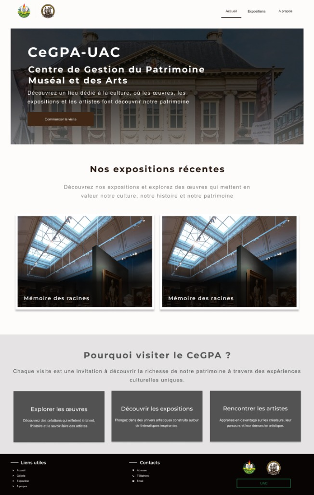
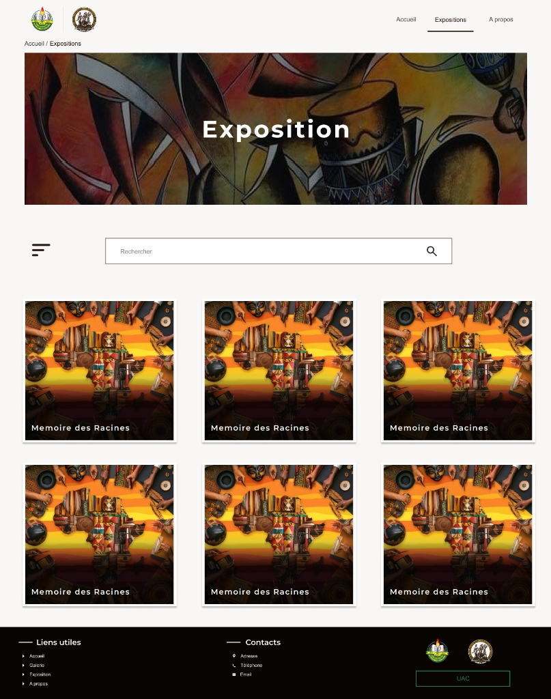
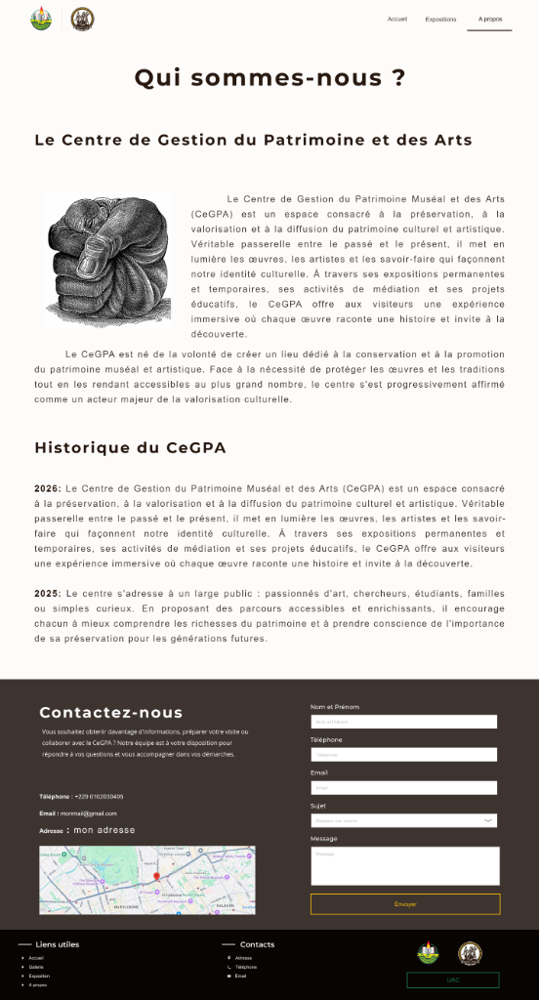
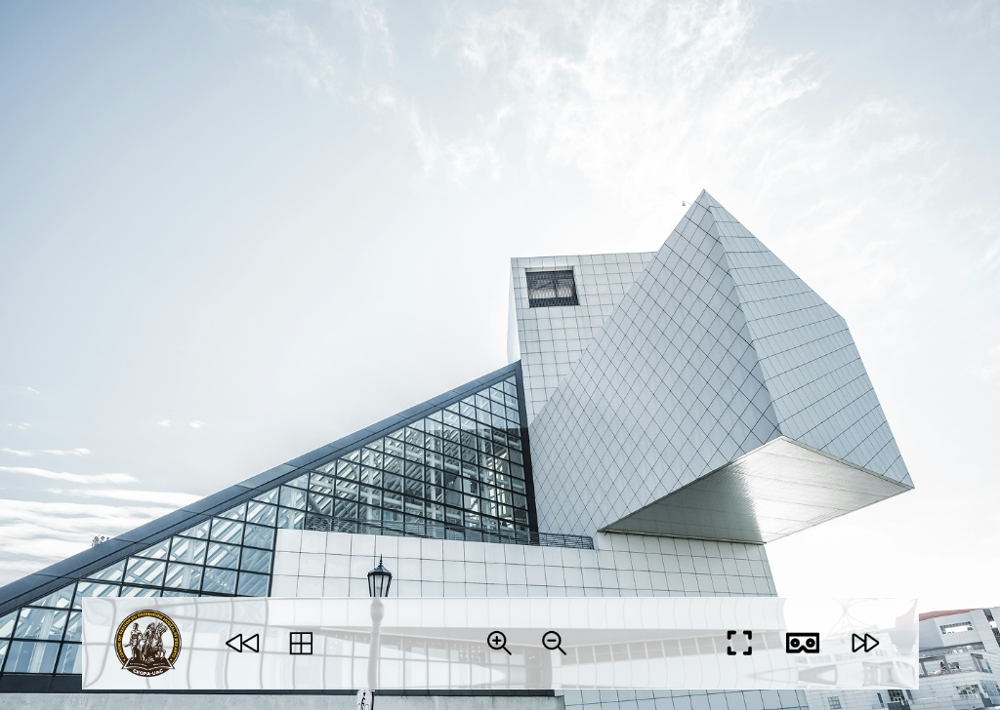
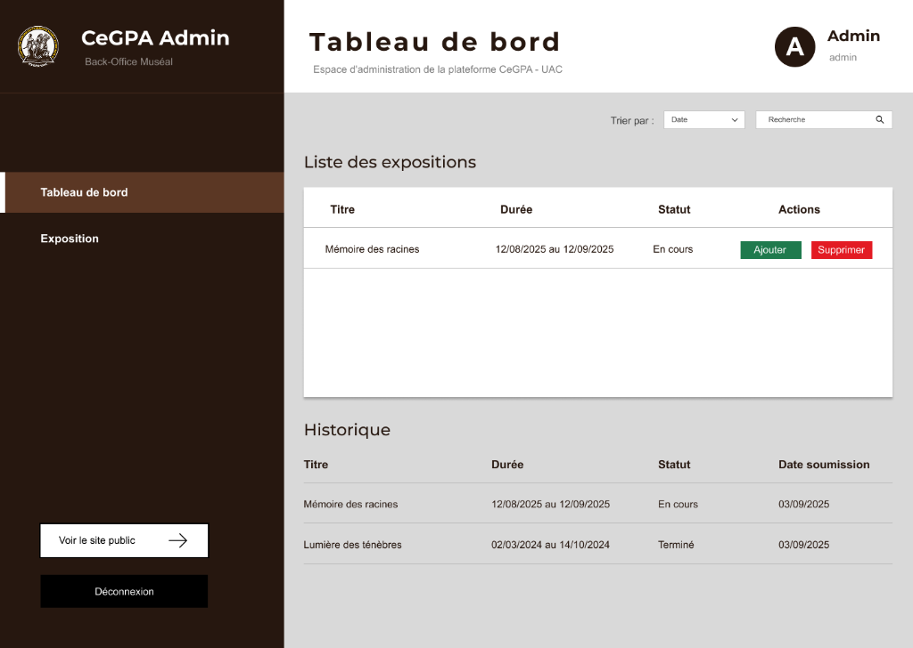

# CeGPA - Centre de Gestion du Patrimoine Muséal et des Arts

Conception UI/UX complète pour la plateforme muséale et culturelle du CeGPA (Université d'Abomey-Calavi - UAC).

---

## Liens du Projet

- Maquette Figma : [Consulter la maquette sur Figma](https://www.figma.com/design/ssnVXgTHPxU04D7b4Gm8dX/CeGPA?node-id=0-1&t=Zvg9zqIAHgrpkJwU-1)
- Site web en ligne : [cegpa.site.je](https://cegpa.site.je)

---

## Périmètre de Conception

Le projet couvre l'intégralité de l'écosystème numérique du musée :
1. **Portail Public :** Accueil, catalogue des expositions, valorisation des œuvres et des artistes, formulaires institutionnels.
2. **Visite Immersive & VR :** Interface de visite virtuelle 360° intégrée avec commandes de navigation (zoom, plein écran, mode casque VR).
3. **Back-Office d'Administration (CeGPA Admin) :** Gestion des expositions, historique, ajout/suppression de contenus et gestion des accès.

---

## Aperçu des Écrans

### 1. Page d'Accueil

### 2. Galerie des Expositions

### 3. Qui sommes-nous & Contact

### 4. Visite Virtuelle 360° / Mode VR

### 5. Back-Office d'Administration (Admin Muséal)

---

## Démarche et Compétences Mises en Œuvre

- **Recherche & Architecture :** Hiérarchie de l'information pour une navigation muséale claire et fluide.
- **Design Visuel & Identité :** Palette sobre et élégante adaptée au contexte muséal et patrimonial.
- **Design System :** Composants réutilisables, typographies harmonisées et boutons d'action.
- **Immersion XR :** Réflexion ergonomique sur l'interface de visite immersive 360° et la compatibilité casque VR.
